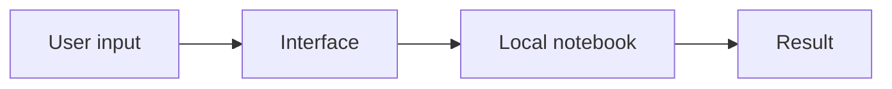
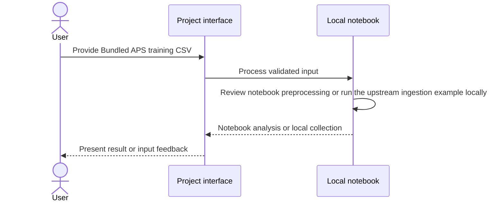
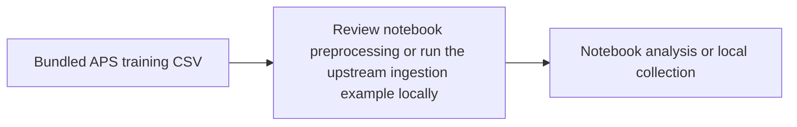

# APS Fault Detection Notebook

## 1. Project overview

Document the upstream APS failure notebook and data-ingestion exercise. This repository is a fork of [yadav-avnish/aps-fault-detection](https://github.com/yadav-avnish/aps-fault-detection).

[Source repository](https://github.com/subhashdixit/aps-fault-detection)

## 2. Motivation and problem statement

### Objective

Document the upstream APS failure notebook and data-ingestion exercise.

### Problem statement

Sensor failures and missing values make a simple raw-table exploration difficult.

### Motivation

The fork is useful as a reference for the original notebook and MongoDB ingestion setup.

## 3. Solution and scope

**Inputs** — Bundled APS training CSV. **Outputs** — Notebook analysis or local collection.

The checked-in example follows the upstream project. It is included here as a runnable reference. [Upstream source](https://github.com/yadav-avnish/aps-fault-detection)

## 4. Quick start and usage

Start with the documented sample or supported input. Review the output and any validation feedback. Use the local setup below.

## 5. High-level architecture

## 6. End-to-end request workflow

## 7. Data sources, inputs, and outputs

| Input | Processing | Output |
| --- | --- | --- |
| Bundled APS training CSV | Review notebook preprocessing or run the upstream ingestion example locally | Notebook analysis or local collection |

## 8. Data flow and ETL pipeline

## 9. Low-level design and interfaces

Implementation entry points are [`main.py`](<main.py>).

## 10. Concepts and algorithms

- **Sensor data**. The APS source uses anonymized measurements and missing-value markers.
- **Document storage**. The upstream example exercises CSV ingestion into a MongoDB collection.

## 11. Technology choices and dependencies

- **Python and Jupyter**. Run and inspect the original exercise one cell at a time.

## 12. Training, inference, and evaluation

Review behavior using the checked-in fixtures and assertions. This application has no project-trained model benchmark.

## 13. Limitations and data handling

Use the project within the scope of its documented inputs, datasets, and evaluation.

## 14. Installation and local setup

Clone [this fork](https://github.com/subhashdixit/aps-fault-detection) and start a Python environment with Jupyter. Open the notebook listed above. Install the dependencies referenced by its imports before running cells.

For the separate MongoDB ingestion example, use a local test database and your own configuration. Install the listed requirements before starting the upstream example. [Dependency list](requirements.txt).

## 15. Repository structure

- [`main.py`](<main.py>)

## 16. Deployment and operations

Run the exercise locally. The repository does not document a maintained deployment.

## 17. License, credits, and support

The repository does not contain a root LICENSE file. Check upstream and data-source terms before reuse. Original project attribution is recorded at [yadav-avnish/aps-fault-detection](https://github.com/yadav-avnish/aps-fault-detection).
